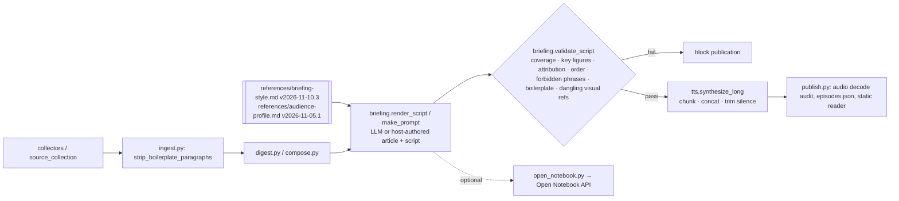

# Issue #42 — Open-source article & podcast generation: landscape, shortlist, PoC plan

**Issue:** [#42](https://github.com/ialchemist-dev/focu/issues/42) (created 2026-11-11T07:43:11Z)
**Evidence captured:** 2026-11-11T08:43:41Z–08:48:01Z UTC (actual clock, see JSON `captured_at`)
**Status:** desk research + API-measured activity. **No installs, no paid model calls, no generated episodes, no production changes.** Adoption is a separate owner decision.
**Raw evidence:** [`evidence/issue-42-activity-snapshot.json`](evidence/issue-42-activity-snapshot.json), [`evidence/issue-42-activity-snapshot-batch2.json`](evidence/issue-42-activity-snapshot-batch2.json), produced by [`tools/oss_activity_snapshot.py`](tools/oss_activity_snapshot.py) from the candidate lists [`evidence/issue-42-candidates.json`](evidence/issue-42-candidates.json) and [`evidence/issue-42-candidates-batch2.json`](evidence/issue-42-candidates-batch2.json).

## 0. Recommendation (short)

| Rank | Candidate | Verdict | Focu stage it touches | Replace / keep / wrap |
|---|---|---|---|---|
| 1 | [lfnovo/podcast-creator](https://github.com/lfnovo/podcast-creator) (engine inside Open Notebook) | **Integrate a component** — evaluate as an *optional* script+TTS engine, behind Focu QC | spoken-script authoring → TTS | Wrap. Keep Focu style file, `focu.briefing.validate_script` (coverage, key figures, attribution, boilerplate, visual refs) as the fail-closed gate on its output |
| 2 | [remsky/Kokoro-FastAPI](https://github.com/remsky/Kokoro-FastAPI) | **Integrate a component** (TTS cost driver only) | TTS | Wrap behind `focu/tts.py`'s OpenAI-speech-shaped call; keep Focu chunking/concat/audio audits |
| 3 | [assafelovic/gpt-researcher](https://github.com/assafelovic/gpt-researcher) | **Borrow the design** (citation-enforcing report prompts, context filtering, local-docs mode); **reject** as article writer | article authoring (design only) | Keep Focu article path; consider porting the "every figure must carry a citation" rule into Focu's own QC, not its prompts |

Not shortlisted but relevant: **Open Notebook** is already Focu's optional podcast backend ([docs/OPEN_NOTEBOOK_MUSE_TEST.md](../OPEN_NOTEBOOK_MUSE_TEST.md), `focu/open_notebook.py`) — it is *active* and qualifies, but a service with SurrealDB + worker; the research value is in its library (`podcast-creator`). **SurfSense** qualifies on activity but is a NotebookLM/Perplexity-style workspace, not a component (reject for Focu). **Podcastfy, STORM, Kokoro (model repo), open_deep_research, Chatterbox** fail or are marginal on the hard activity requirement (§2).

Nothing found replaces Focu's **fail-closed, source-grounded QC**: none of the candidates ships numeric-fidelity checks, item-coverage manifests, or boilerplate gates comparable to `focu/briefing.py`. Every adoption path therefore *wraps* a candidate behind Focu's existing gates.

## 1. Focu's current pipeline (baseline)

Read from this repository at commit `dee2e5d` (main, 2026-11-10).

Owner-controlled customization today: the versioned YAML block + prose rules in `references/briefing-style.md` (agenda opening, single voice, no theatrics, no invented numbers, no boilerplate, no dangling visuals, 5–8 min target) and `references/audience-profile.md`. **This research does not change either file.** Any candidate must consume these as inputs rather than replace them with its own personas.

## 2. Candidate matrix with dated activity (hard requirement)

Definitions (identical for every row; see the script docstring): *commits 90d* = default-branch commits with committer date ≥ window start recorded per JSON (batch 1: 2026-08-13T08:43:41Z; batch 2: 2026-08-13T08:46:49Z); *contributors 6mo* = distinct commit authors (login, else name) on the default branch since now−182 d (2026-05-13T08:43:41Z / 08:46:49Z), bots separated; *issues* = GitHub search `is:issue` opened/closed since 2026-08-13; *maintainer response* = among the ≤15 most recent non-maintainer issues opened in the 90-day window, how many have a comment from an OWNER/MEMBER/COLLABORATOR (conservative: maintainers with only CONTRIBUTOR association are missed). `pushed_at` is stored but **not** used as activity.

| Repo | License | ★ | Commits 90d | Human contributors 6mo | Last default-branch commit | Latest GitHub release | Issues opened / closed 90d (open now) | Maintainer reply in sample (median h) | Activity verdict |
|---|---|---:|---:|---:|---|---|---|---|---|
| lfnovo/open-notebook | MIT | 41,843 | 114 | 61 | 2026-11-08 | v1.15.1 (2026-11-04) | 86 / 56 (132) | 10/13 (221 h) | **Active** |
| lfnovo/podcast-creator | MIT | 130 | 33 | 2 | 2026-10-04 | v0.13.1 (2026-10-04) | 4 / 14 (1) | 1/1 (189 h) | **Active, small team** (bus-factor risk) |
| assafelovic/gpt-researcher | Apache-2.0 | 30,626 | 272 | 72 | 2026-11-09 | v3.8.0 (2026-11-09) | 39 / 86 (3) | 6/15 (536 h) | **Active** |
| remsky/Kokoro-FastAPI | Apache-2.0 | 5,669 | 138 | 22 | 2026-11-10 | v0.10.0 (2026-11-08) | 22 / 100 (8) | 9/10 (88 h) | **Active** |
| MODSetter/SurfSense | Apache-2.0 | 16,837 | 3,423 | ≥29 (**lower bound**: scan truncated at 2,000 commits) | 2026-11-03 | v2.3.1 (2026-11-03) | 140 / 202 (54) | 10/14 (3 h) | Active (not a component fit) |
| resemble-ai/chatterbox | MIT | 27,757 | 1 | 3 | 2026-11-04 | v0.1.2 (2025-06-13) | 17 / 1 (289) | 0/15 | **Marginal** — 1 commit/90d, no maintainer replies in sample; not qualified |
| souzatharsis/podcastfy | Apache-2.0 | 6,801 | 0 | 0 | 2026-05-04 (outside 6-mo window) | v0.4.0 (2024-11-16) | 5 / 0 (90) | 0/5 | **Rejected — dormant** |
| stanford-oval/storm | MIT | 31,853 | 0 | 0 | 2025-09-30 | v1.1.0 (2025-01-23) | 7 / 1 (64) | 0/7 | **Rejected — dormant** |
| langchain-ai/open_deep_research | MIT | 12,678 | 0 | 0 (1 bot) | 2026-08-10 | none | 0 / 0 (39) | — | **Rejected — archived** |
| hexgrad/kokoro (model/library) | Apache-2.0 | 10,053 | 0 | 0 | 2025-08-06 | none | 17 / 2 (180) | 0/15 | **Rejected — dormant** (note: Kokoro-FastAPI, which serves this model, is active) |

Stars are a popularity snapshot, not quality. Release dates come from GitHub Releases only (tags/PyPI not counted). GPT Researcher's "open now = 3" alongside 86 closed suggests aggressive triage/auto-close; that is recorded, not interpreted as quality.

## 3. What each qualifying candidate actually provides (primary sources, accessed 2026-11-11)

### 3.1 podcast-creator (and Open Notebook, which embeds it)
- **Architecture:** pip library; LangGraph workflow *outline → transcript → per-line TTS → combine* ([README](https://github.com/lfnovo/podcast-creator/blob/main/README.md); [`src/podcast_creator/nodes.py`](https://github.com/lfnovo/podcast-creator/blob/main/src/podcast_creator/nodes.py)). Open Notebook documents the same three stages and states outline and transcript models see *all selected content* ([podcasts-explained.md](https://github.com/lfnovo/open-notebook/blob/main/docs/2-CORE-CONCEPTS/podcasts-explained.md)).
- **Customization surface:** Jinja prompt templates `prompts/podcast/outline.jinja` and `transcript.jinja` (overridable via `configure("templates"|"prompts_dir")`), `speakers_config.json` (1–4 speakers with backstory/personality, per-speaker TTS provider/voice), `episodes_config.json` *episode profiles* (models, `default_briefing`, `num_segments`) ([README](https://github.com/lfnovo/podcast-creator/blob/main/README.md), [`episodes_config.json`](https://github.com/lfnovo/podcast-creator/blob/main/episodes_config.json)). These are file-based and versionable, so Focu's style file could be rendered into a *custom* transcript template + a single-speaker profile — this matches Focu's "owner specs in versioned files" contract better than any other candidate.
- **QC hooks:** `validators.py` checks template syntax/required variables, speaker config schema and voice IDs; the transcript parser validates speaker names; retries with exponential backoff. **No** source-coverage, numeric-fidelity or attribution checks ([`validators.py`](https://github.com/lfnovo/podcast-creator/blob/main/src/podcast_creator/validators.py)).
- **Default persona conflicts with Focu policy:** shipped profiles are panel/"engaging discussion" briefings (e.g. `diverse_panel`: "Encourage debate…"), i.e. exactly the theatrical/interpretive output Focu's style forbids. Only a custom single-speaker profile + template is compatible.
- **Samples:** README links a 4-speaker and a [one-speaker sample](https://soundcloud.com/lfnovo/single-speaker-podcast-on-situational-awareness) (external audio; not reproduced here).
- **Cost drivers:** outline + transcript LLM calls over all content plus TTS for the full script; local models/TTS reduce per-call cost ([podcasts-explained.md §Cost](https://github.com/lfnovo/open-notebook/blob/main/docs/2-CORE-CONCEPTS/podcasts-explained.md)).

### 3.2 Kokoro-FastAPI
- Dockerized Kokoro-82M server with "OpenAI-compatible Speech + Realtime (TTS only) endpoints", CPU and NVIDIA GPU images ([README](https://github.com/remsky/Kokoro-FastAPI/blob/master/README.md)). Focu's `focu/tts.py` already targets an OpenAI-shaped `/v1/audio/speech` request with its own chunking (`chunk_script`), concatenation and silence trimming, so the integration surface is the endpoint/model/voice of that one call (today `API_URL` is a hard-coded constant, so a small, separately approved config change would be needed), not a pipeline change. **Unknowns:** voice quality vs Focu's current `gpt-4o-mini-tts` output on a real script (not listened to); upstream model repo `hexgrad/kokoro` is dormant, so model improvements are not expected.

### 3.3 GPT Researcher
- Planner/executor research agent producing cited reports; supports local documents (`report_source="local"`) and MCP sources ([README](https://github.com/assafelovic/gpt-researcher/blob/main/README.md)).
- Report prompt requires "Every substantive claim, figure or quote MUST carry an in-text citation… Do NOT cite sources that do not appear in the provided information" ([`gpt_researcher/prompts.py`](https://github.com/assafelovic/gpt-researcher/blob/main/gpt_researcher/prompts.py)) — a **prompt-level** instruction, not a verifier. Customization: `PromptFamily` subclassing, config docs ([docs/gpt-researcher/gptr/config.md](https://github.com/assafelovic/gpt-researcher/blob/main/docs/docs/gpt-researcher/gptr/config.md)).
- Fit: its purpose (web research, "aggregate over 20 sources", analysis/conclusions) conflicts with Focu's daily-briefing rule "never add interpretations… keep every input item". Reject for the daily article; design reference only, possibly for owner-commissioned research reports (separate decision).

## 4. Stage mapping (replace / keep / wrap)

| Focu stage | Kept as-is | Candidate option | Mode |
|---|---|---|---|
| Collection, ingest, boilerplate stripping | ✔ | none better found | keep |
| Style/audience spec (versioned files) | ✔ (source of truth) | podcast-creator templates/profiles *generated from* the style file | wrap |
| Article authoring | ✔ | GPT Researcher citation pattern | borrow design |
| Spoken-script authoring | ✔ default | podcast-creator transcript node (single speaker) | integrate component, optional |
| Fail-closed QC (`validate_script`, boilerplate, visual refs) | ✔ **mandatory on any candidate output** | none of the candidates ship equivalent | keep |
| TTS | ✔ chunking/concat/audits | Kokoro-FastAPI as backend | integrate component |
| Publish/reader | ✔ | (see issue #43) | keep |

## 5. Proof-of-concept plan for the top candidate (plan only — not executed)

Goal: side-by-side comparison on **the same inputs as a recent real episode**, without production changes.

1. **Fixture:** owner picks one already-published daily delivery (e.g. the Nov 9 episode used in [MUSE_IOS_READER_ISSUES_31_34_ACCEPTANCE.md](../MUSE_IOS_READER_ISSUES_31_34_ACCEPTANCE.md)). Copy its ingested units (post-`strip_boilerplate_paragraphs`) read-only into an ignored scratch dir; record source hashes. Do not commit private content.
2. **Isolation:** new venv in a scratch worktree; `pip install podcast-creator` there only (needs separate install authorization).
3. **Config derived from the versioned spec, no invented preferences:** single speaker; `transcript.jinja` = Focu `make_prompt` rules (agenda opening, order, exact figures, attribution, forbidden phrases); `num_segments` = item count; record the style version (`2026-11-10.3`) in the run manifest.
4. **Generate** script (and, if the owner approves the spend, audio) using the provider already configured for Focu; with Kokoro-FastAPI as a zero-API-cost TTS arm if authorized.
5. **Gate:** run `focu.briefing.validate_script` and `find_boilerplate` / `dangling_visual_refs` on the candidate script. A QC failure is a result, not something to patch by hand.
6. **Article arm:** podcast-creator produces no article; keep Focu's article for the comparison, or (separately) a GPT Researcher `report_source="local"` report over the same units for design comparison only.
7. **Deliverable:** private comparison bundle (Focu vs candidate script, QC report, durations, cost/usage as measured) for owner listening. **No claim of output quality until rendered and heard by the owner.**

Acceptance for the PoC: zero QC regressions vs Focu baseline, no theatrics/forbidden phrases, measured cost and wall time recorded, owner listening verdict.

## 6. Known unknowns and limitations
- No candidate was installed or run; no sample was rendered or listened to here. Quality claims are limited to what repositories document.
- Contributor counts are commit-author based on the default branch only; SurfSense is a lower bound. Maintainer-response rate misses CONTRIBUTOR-association maintainers.
- Search API counts can include issues later transferred/locked; numbers are a dated snapshot and will drift.
- podcast-creator has 2 human contributors in 6 months — adoption risk if the maintainer stops; mitigated because Focu would wrap it, not depend on it.
- Long-form chunking/voice continuity of podcast-creator's per-line TTS vs Focu's chunk-concat path is unmeasured.
- Closed/SaaS baselines (NotebookLM, ElevenLabs Studio) were not evaluated per the issue's non-goals.
